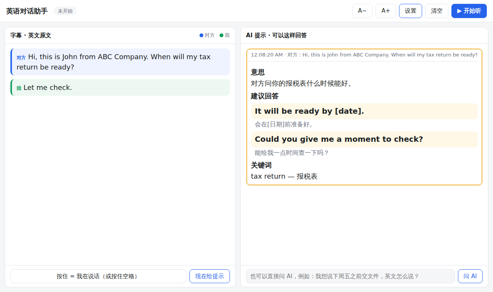

# 英语对话助手（AI-aid Listening and Answering）

英语不好也能打英文电话、和外国人当面交流：

- **左边：字幕**。把对方（和你自己）说的英文实时变成文字。
- **右边：AI 提示**。对方说完一句，AI 马上给出简单的**英文**回答建议（通话中只出英文，这样最快）。最新的在最上面。
- **通话后：回顾**。点右上角「📋 回顾」，按时间先后一句对一句排列：左边是对方说的话，右边是 AI 当时的建议。再点「生成中文解释和关键词」，一次性生成每句话的中文意思、建议的中文翻译和关键词。还可以「下载记录」保存成文本文件。

你看着提示，再用自己的话说出来就行。



## 一、安装（只需要做一次）

1. 安装 [Node.js](https://nodejs.org/) 22 或更新版本。
2. 下载本项目，在项目文件夹里打开终端，运行：
   ```bash
   npm install
   ```
3. 把 `.env.example` 复制一份，改名为 `.env`，填入两个 Key：
   - `DEEPGRAM_API_KEY`：把英文语音转成文字（<https://console.deepgram.com/>）。
   - `GEMINI_API_KEY`：根据对话生成文字回答提示（<https://aistudio.google.com/apikey>）。

   流程是：**声音 → Deepgram 转成英文文字 → Gemini 生成回答提示（只出文字，不出声音）**。

### Mac：双击启动

安装好 Node.js 后，双击项目文件夹里的 **`start-mac.command`**。

- 第一次如果提示 "Apple could not verify … is free of malware"（无法验证是否含有恶意软件）：点「完成」（不要点「移到废纸篓」），然后在终端里运行一次下面这行，以后就能直接双击了：
  ```bash
  xattr -d com.apple.quarantine ~/Documents/AI-aid-Listening-And-Answering/start-mac.command
  ```
  或者打开「系统设置 → 隐私与安全性」，在下方找到这个文件被阻止的提示，点「仍要打开」。
- 第一次会自动安装组件，并用「文本编辑」打开 `.env`，填好 Key、保存、关闭后，回到终端窗口按回车。
- 之后每次双击都会启动程序，并自动用 Chrome 打开页面。终端窗口不要关。

### Windows 电脑：双击启动

1. 安装 [Node.js](https://nodejs.org/) 的 **LTS** 版本（下载 Windows 安装包 .msi，一路"下一步"）。
2. 解压项目文件夹，双击里面的 **`start-windows.bat`**。
   - 第一次会自动安装依赖，并用记事本打开 `.env`：填好 Key，保存（`Ctrl + S`），关掉记事本，程序就会启动。
   - 之后每次双击都会直接启动，并自动在浏览器里打开页面。
   - 黑色窗口不要关，关了程序就停了。
3. 如果 Windows 提示"Windows 已保护你的电脑"，点「更多信息」→「仍要运行」。

## 二、使用

```bash
npm start
```

然后用 **Chrome 或 Edge** 打开 <http://localhost:3000>，点右上角「设置」选好模式，再点「▶ 开始听」。

### 选哪种模式？

| 你的情况 | 语音识别 | 对方的声音从哪来 |
| --- | --- | --- |
| 手机打电话，开**免提外放**放在电脑旁边 | Deepgram | 麦克风 |
| 当面和人说话 | Deepgram | 麦克风 |
| 用电脑打电话（Zoom、Teams、Google Meet、WhatsApp 网页版、网络电话等） | **Deepgram** | 电脑声音 |

- **智能区分说话人**（麦克风模式 + Deepgram，默认）：只有一个麦克风时，程序同时用几种线索判断是谁在说：
  1. **声音特征**：你对着电脑麦克风说话，声音大、频带宽；手机外放出来的声音被电话压缩过，几乎没有很低和很高的频率（面对面时对方离麦克风远，声音也小一些）。程序把听到的声音自动分成两组，再判断哪组是你。
  2. **你念的提示**：你照着右边的 AI 提示说出来的话，会被认出来是「我」，不会再给你自己的话生成提示；这些话也用来学习你的声音。
  3. **Deepgram 自动区分说话人**：Deepgram 给每个声音一个编号（字幕里的「声音1」「声音2」）。
  4. **按住空格**：按住时说的话一定算「我」。开始后先按住空格说一句英文，程序会学得更快。

  刚开始需要几句话来学习（字幕上方的小标签显示「正在学习」），学会后会显示「已分清你和对方 ✓」，并把前面标错的字幕改过来。认反了点字幕下方的「⇄ 对调」。为了听清原始声音，这个模式会关掉浏览器的降噪和自动音量。
- **手动区分**：在「设置 → 区分说话人」里选「手动」，默认都算「对方」，**你自己说话时按住空格键**（或按住左下角的按钮）。用 Deepgram 时按**每个单词**说出的时间判断，就算对方紧接着开口也能分开。照着提示念的话也会自动算「我」。（浏览器自带识别没有单词时间，只能按句子判断，没那么准。）
- **电脑声音模式**：点开始后，浏览器会弹出「选择要分享的内容」：
  - Windows：选「整个屏幕」，并勾选 **「同时分享系统音频」**。可以录到任何软件的声音（Zoom 客户端、Teams、微信电话、WhatsApp 等）。
  - Mac：Chrome 只能分享**某个标签页**的声音（选「Chrome 标签页」并勾选「分享标签页音频」），适合网页版会议。
  - 这时对方的声音走电脑声音，你的声音走麦克风，程序会自动分清「对方」和「我」。**建议戴耳机**，不然麦克风会把对方的声音也录进去。

### 面试模式和「我的资料」

用来回答面试问题时：

1. 打开「设置」，把**场景**改成「面试」。
2. 在「我的资料」里**上传文件**（PDF、Word .docx、TXT、Markdown），或者点「粘贴文字」直接粘贴。建议上传：
   - 简历
   - 项目经历、工作中做过的事（具体的数字、成果越多越好）
   - 这次面试的职位描述（JD）
   - 自己准备好的自我介绍、常见问题的回答
3. 面试官提问时，AI 会**按你的资料**写出第一人称的英文回答（"I ..."），拆成 3~6 句短句，方便你一句一句说。行为面试题（"Tell me about a time..."）按 STAR 结构回答。
4. 资料里**没有提到**的问题，AI 会用一般知识回答，需要个人细节的地方用 `[your example]` 这样的占位符。AI 不会编造你的经历。
5. 面试结束后用「📋 回顾」复盘，生成中文解释和关键词。

说明：

- 每份资料前面的勾选框可以临时停用（例如换一家公司面试时，停用旧的 JD）。
- 顶部的小标签会显示当前场景和正在参考几份资料。
- 资料保存在你电脑上项目里的 `data/profile.json`，不会上传到 GitHub（已加入 `.gitignore`）。每次生成提示时，启用的资料会作为参考发给 Gemini。
- 扫描件或图片做的 PDF 读不出文字，请把内容复制成文字后用「粘贴文字」添加。
- 单份资料最多 6 万字符，所有启用的资料加起来最多 15 万字符（资料越长，每次提示越慢）。
- 「一般对话」场景下也会参考资料，比如对方问到你的工作经历时。

### 提示的速度

- 程序像 voice agent 一样「抢跑」：对方**还在说**的时候（不用等这句话确认），AI 就在**后台**按已经听到的内容准备回答，但**先不显示**；对方接着说，后台最多每 0.7 秒按新内容重新准备一次，听到问号马上准备。提示栏上方会显示「AI 正在提前准备」/「已准备好」。
- **对方说完了才显示**：Deepgram 判断这句话结束（停顿 0.3 秒并且句子以 . ? ! 结尾，或安静了 1 秒），就把按完整内容准备好的建议一次显示出来。
- **一轮一张卡片**：对方连续说的几句算同一轮，合成一张卡片；你说完话、对方开始新的一轮，才出现新卡片。建议只有 1~2 条，第一条是最切题的。
- 每张卡片右上角的 **⚡x.x 秒** 是从对方说完到提示出现的时间（提前准备好了就是 0 秒）；终端里也会显示 `[提示] AI 首字 … 秒`。
- 终端里每次请求都会显示用了多少 token（输入 / 输出 / 思考）和本次启动以来的累计，可以用来估算费用、对照 AI Studio 的用量页面。「思考」也按输出计费。
- 通话中默认用 **`gemini-flash-lite-latest`**（首字最快），通话后的中文解释用 `gemini-flash-latest`。觉得回答质量不够、愿意慢一点：在 `.env` 里加 `GEMINI_MODEL=gemini-flash-latest`。
- 点「开始听」时程序会先发一个极短的请求，建立好网络连接，并试出模型支持的思考档位（不支持 MINIMAL 就改成不思考或 LOW，终端里会提示一次），第一条提示就不用多等。
- 「抢跑」会多发一些请求（对方一句话可能准备 2~3 次，没用上的会中途取消），费用比以前稍高；上传的资料越少、越短，AI 越快也越便宜。

### 录音和回放

「设置」里的「录音」默认打开：程序会把双方的声音录下来。

- 回顾时，**点左边任意一句话**就会播放那一句的录音，再点一下停止。
- 用 Deepgram 时，每句话在录音里的位置是 Deepgram 给出的，比较准；用「浏览器自带」识别时只能按时间估算，可能会前后差一两秒。
- 点「下载录音」可以把整段对话（双方混在一起）存成一个 .wav 文件。
- 录音只保存在当前网页里，**刷新页面或点「清空」后就没有了**，需要保留请先下载。录一小时大约占用 100~200 MB 内存。
- 录音前请先征得对方同意，有些地方的法律要求通话录音必须告知对方。

### 其它功能

- **背景信息**：在设置里写上你是谁、这通电话大概是关于什么（可以写中文），AI 的建议会更贴切。
- **现在给提示**：自动提示没出来、或想让 AI 再想一次时点它。
- **问 AI**：右下角可以直接输入中文问题，比如「我想说下周五之前交文件，英文怎么说？」
- **A− / A+**：调整字体大小。
- 对方连续说话时，旧的提示会自动停止，换成根据最新内容的提示。

## 三、费用和隐私

- Deepgram 按识别时长收费，新用户有免费额度。（没有 Deepgram 时也可以在设置里选「浏览器自带」识别，免费但没那么准。）
- Gemini 按用量收费（有免费额度）；每条提示发送最近 30 句对话文字、你的背景信息和启用的资料，不发送声音。
- 服务器默认只在你自己电脑上运行（只监听 `127.0.0.1`），API Key 保存在 `.env`，不会发到浏览器。

## 四、技术说明

```
浏览器 (public/)                      本机 Node 服务器 (server.js)
 ├─ 麦克风 / 电脑声音                   ├─ /ws/stt   → Deepgram 实时识别（转发音频）
 ├─ Web Speech API（浏览器自带识别）      └─ /api/hint → Gemini（流式返回文字提示）
 ├─ 左：字幕    右：AI 提示卡片
```

- `src/prompt.js`：给 AI 的提示词（一般对话 / 面试两种回答格式、用简单英文等规则），想调整 AI 的回答风格就改这里。
- `src/docs.js`：「我的资料」的上传、文字提取（PDF 用 unpdf，Word 用 mammoth）和保存。
- `src/ai/gemini.js`：调用 Gemini（通话中默认 `gemini-flash-lite-latest`、最少思考；回顾用 `gemini-flash-latest`）。
- `public/speaker.js`：智能区分说话人（声音特征分组、认出照着提示念的话）；声音特征在 `public/pcm-worklet.js` 里按原始采样率每 20ms 算一次。
- `src/ai/claude.js`：备用。没填 `GEMINI_API_KEY`、填了 `ANTHROPIC_API_KEY` 时改用 Claude。
- `src/deepgram.js`：Deepgram 实时识别的 WebSocket 转发。
- `public/pcm-worklet.js`：把音频转成 16kHz PCM 发给服务器。
- 可在 `.env` 用 `GEMINI_MODEL`（通话中）/ `GEMINI_REVIEW_MODEL`（回顾）/ `GEMINI_THINKING` 调整模型和通话中的思考深度（默认 `minimal`，最快）。
- 回顾时的中文解释走 `/api/explain`，用 JSON 格式一次返回多句（每批 8 句，同时 3 批）。
